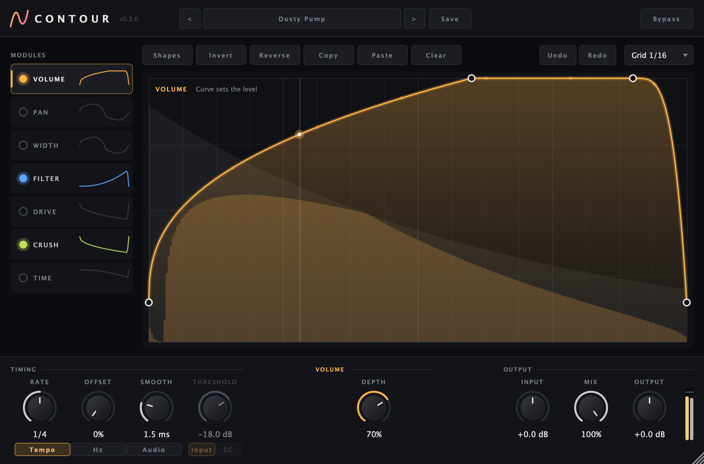

# Contour

**Draw a curve, shape your sound in time with the music.** Contour is a multi-effect "shaper" plugin in the
spirit of ShaperBox: each module (volume, pan, width, filter, drive, crush, time) gets its own curve that
plays in sync with your DAW, so pumping sidechains, gates, auto-pans, filter sweeps, tape stops and
stutters are all a curve away.

AU · VST3 · Standalone — macOS (Windows VST3 builds in CI) — built with [JUCE](https://juce.com)



## Features

- **Seven modules**, each with its own curve, on/off switch and depth, stacked in one plugin:
  - **Volume** — sidechain pumps, gates, swells
  - **Pan** — equal-power auto-pan and ping-pong
  - **Width** — from mono to extra-wide (mid/side)
  - **Filter** — low-pass, high-pass or band-pass with resonance
  - **Drive** — tanh saturation, roughly loudness-compensated
  - **Crush** — bit depth and sample-rate reduction
  - **Time** — a curve-controlled delay: slopes slow down (tape stop), steps repeat (stutter), steep slopes reverse
- **Three trigger modes**
  - **Tempo** — locked to the host's transport and song position; freezes when playback stops
  - **Hz** — free-running LFO
  - **Audio** — restarts the curve on each hit, from the track itself or from the **sidechain input**
    (duck the bass from the kick)
- **Rates** from 1/32 to 8 bars, including triplets and dotted values; bar-based rates follow the time signature
- **Curve editor** with grid snapping, bendable segments, shapes, invert, reverse, copy/paste between modules
  and instances, and undo/redo
- **Waveform display** of the audio behind the curve, before and after processing
- **Output section** — input gain, dry/wet mix, output gain with meter, click-free bypass
- **Presets** — 24 factory presets in categories, plus your own saved as files you can share

## Install

There are no signed downloads yet, so for now Contour is built from source (it takes a few minutes):

1. Install Xcode (or its Command Line Tools) and the build tools:
   ```
   xcode-select --install
   brew install cmake ninja
   ```
2. Build:
   ```
   git clone https://github.com/matiasconcha11/contour.git
   cd contour
   make
   ```

The build installs the plugin into `~/Library/Audio/Plug-Ins/` (AU in `Components`, VST3 in `VST3`).
Restart your DAW and look for **Matias Concha → Contour**. A standalone app is also built in
`build/Contour_artefacts/Release/Standalone/`.

## Using it

**Editing curves**
- drag a point to move it (the first and last points stay linked so the loop is seamless)
- drag between two points to bend that segment
- double-click to add a point; double-click or right-click a point to remove it
- hold Cmd while dragging to place points off the grid

**Sidechain (duck from the kick) in Logic Pro**
1. Put Contour on the track to duck and load the **Kick Duck (Sidechain)** preset
2. In the **Side Chain** menu at the top of the plugin window, choose the kick track
3. Adjust **Threshold** until the trigger light flashes on every kick

**Presets** are saved as `.contourpreset` files in `~/Library/Audio/Presets/Matias Concha/Contour/`
(or `~/Documents/Contour Presets` if that folder isn't writable). Copy them to another machine to share them.

## Development

```
make            # Release build, installed into ~/Library/Audio/Plug-Ins/
make debug      # Debug build in build-debug/ (JUCE assertions on)
make test       # unit tests (Catch2)
make validate   # pluginval at strictness 10 on the VST3 and AU
make check      # test + validate

./build/ContourTests "[.snapshot]"   # render the editor to /tmp/contour.png (CONTOUR_SNAPSHOT_PRESET=n for a preset)
```

The first build downloads JUCE and Catch2. CI builds and tests on macOS (unit tests, pluginval, auval) and
Windows (unit tests) on every push.

**Releases:** pushing a version tag (`git tag v0.3.0 && git push --tags`) builds a universal macOS AU + VST3 and a
Windows VST3 and attaches them to a draft GitHub release. The macOS builds aren't notarized yet, so macOS will
block them on other machines until they are.

## Status

Contour is young and actively developed: tested in Logic Pro on macOS. Bug reports and ideas are welcome in
[Issues](https://github.com/matiasconcha11/contour/issues).

See also **[Duck](https://github.com/matiasconcha11/duck)**, a one-knob sidechain plugin.
